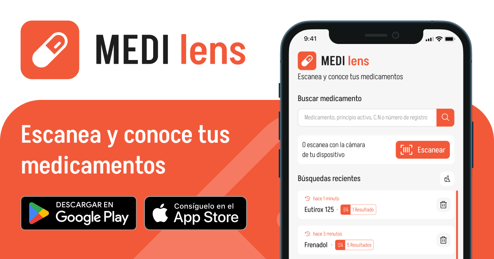

<div align="center">


  # MEDI lens

  **Escanea y conoce tus medicamentos al instante**

  <p>
    <a href="https://medilens.es/">Web oficial</a> ·
    <a href="https://medilens.es/descarga">Descargar la app</a> ·
    <a href="https://medilens.es/soporte">Soporte</a>
  </p>

  [](https://app.netlify.com/sites/medilens/deploys)
</div>

---

## Acerca del proyecto

Este repositorio contiene la landing page oficial de **MEDI lens**, una aplicación gratuita para Android e iOS que facilita el acceso a información fiable sobre medicamentos.

MEDI lens permite escanear códigos de barra, consultar prospectos y fichas técnicas, organizar un botiquín digital y recibir avisos de caducidad desde el móvil.

<div align="center">
  
</div>

## Qué ofrece MEDI lens

- **Escaneo y búsqueda** de medicamentos mediante código de barras o nombre.
- **Información oficial** de la AEMPS, siempre accesible desde el dispositivo.
- **Prospecto y ficha técnica** reunidos en una consulta rápida.
- **Botiquín digital** para guardar medicamentos y controlar fechas de caducidad.
- **Alertas de caducidad** antes de que los productos pierdan su vigencia.
- **Accesibilidad** compatible con TalkBack y VoiceOver.
- **Diseño multiplataforma**, disponible para Android e iPhone.

## Sobre este sitio

La web está creada con **Astro 7** y JavaScript vanilla. El despliegue se realiza en **Netlify**, con integración específica para el adaptador de Astro y una Edge Function configurada para el proyecto.

```text
src/
├── assets/       # Imágenes e iconos procesados por Astro
├── components/   # Componentes reutilizables
├── layouts/      # Plantillas generales y estructura de página
├── pages/        # Rutas y páginas de la web
├── scripts/      # JavaScript del sitio
└── styles/       # Estilos globales

public/           # Recursos estáticos copiados directamente
netlify/          # Edge Functions
netlify.toml      # Configuración de Netlify
```

## Requisitos

- Node.js **24.22.3** o superior
- npm **11.3.0** o superior

## Desarrollo local

```bash
# Instalar dependencias
npm install

# Iniciar el entorno de desarrollo
npm run dev

# Crear la versión de producción en dist/
npm run build

# Previsualizar la compilación
npm run preview
```

## Enlaces

- **Web:** [medilens.es](https://medilens.es/)
- **Contacto:** [medilens.es/contacto](https://medilens.es/contacto)
- **Patrocina MEDI lens:** [medilens.es/patrocina-medilens](https://medilens.es/patrocina-medilens)
- **Prensa:** [prensa@medilens.es](mailto:prensa@medilens.es)

---

<div align="center">
  <sub>MEDI lens · Conoce mejor tus medicamentos.</sub>
</div>
